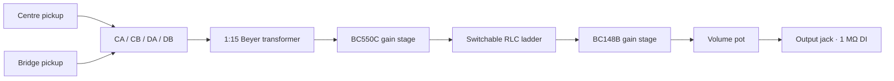

# D6 pickup selector and output jack

The three-key prototype can drive the loaded mono jack of a BC550C D6 board from its two open-circuit pickup signals. The Rust panel accepts pickup EMFs in volts. Each pickup setting uses the same 1 MΩ DI and 100 kΩ linear volume pot. All 16 tone combinations and both observed paired-pickup polarity assignments are available. [Hohner service instructions, drawing 710314, p. 8](https://www.jupitervintagepianos.com/wp-content/uploads/2023/10/Hohner-Clavinet-D6.pdf) · [D6 board layout](https://www.clavinet.com/d6_layout.pdf) · [Pickup-switch assignments and parallel wiring](https://chicagoelectricpiano.com/blogs/news/clavinet-controls-and-settings)



## Circuit and assumptions

- **Transformer and sources.** Solo positions present one pickup to the primary. The paired positions use two equal sources in parallel and reverse one winding for opposition. Fig. 9 of the D6 study shows approximately 10.1–10.9 kΩ over the audio band. An E7 owner measured 180 Ω and 220 Ω at the disconnected pickup leads. Those observations disagree in absolute magnitude, and the D6 recording unit’s terminal measurements are unavailable. The prototype assumes 200 Ω per raw coil and an approximately resistive source, with 100 Ω source resistance for the pair. The 1:15 turns ratio comes from Hohner. The 6 H primary inductance and 70 Ω / 10 kΩ winding resistances come from the related catalogued TR-145/BV35570. The drawing specifies BV35569. Transformer leakage, saturation and winding capacitance require measurements on that part. [D6 study, §2.3.5 and Fig. 9](https://link.springer.com/article/10.1186/1687-6180-2013-103) · [Disconnected E7 pickup measurements](https://www.sequencer.de/synthesizer/threads/jemand-mit-einem-hohner-clavinet-d6-oder-e7-hier.66916/) · [Gotham/Beyer catalog, p. 1484](https://www.technicalaudio.com/pdf/Electronics_Catalog_Extracts/Gotham_Beyer_transformer_Preh_fader_1966_REM_E30.pdf)
- **First transistor.** Factory drawing 710314 shows a BC413C, a 3.9 MΩ collector-to-base feedback resistor and a 100 kΩ base-to-ground shunt. With 9 V power, that divider can supply at most 0.225 V to the base. The literal circuit gives an essentially cut-off input stage. Kipness’s BC550C board layout shows the 3.9 MΩ feedback resistor and omits that shunt. The probe uses this populated configuration. In the deck, changing `RBASE` from its open value to `100k` reproduces the drawing. At 27 °C the modeled Q1/Q2 collectors are 1.88 V and 5.55 V, with small-signal transconductances of 5.38 and 13.33 mS. Transistor β, saturation current and Early voltage in the deck are representative estimates. [Hohner, p. 8](https://www.jupitervintagepianos.com/wp-content/uploads/2023/10/Hohner-Clavinet-D6.pdf) · [BC550C board layout](https://www.clavinet.com/d6_layout.pdf)
- **Tone tabs.** Each enabled tab opens a short around one section of the ladder to ground. From the signal node down, the sections are 30 kΩ ∥ 100 nF, 10 kΩ ∥ 15 nF, 2 H ∥ 4.7 nF, and 0.6 H. Estimated series coil resistances of 43 Ω and 20 Ω limit the cancellation depth. The extra 30 kΩ and 10 nF feeding Q2 load the complete ladder. Closing all four shunts grounds its input. The Rust implementation uses ideal shunts. The AC check uses 1 mΩ closed contacts. [Hohner drawing](https://www.clavinet.com/Clavinet_D6_schematic.pdf) · [Gabrielli et al., Fig. 11](https://link.springer.com/article/10.1186/1687-6180-2013-103)
- **Output level.** The panel models the small-signal response at fixed 9 V. Absolute pickup sensitivity, battery impedance, transistor compression, resistor tolerances and DI capacitance remain uncalibrated. Gabrielli et al. report approximately 1% THD in their polyphonic test and 3.6% on the loudest peaks. The Rust transfer is linear at both levels. [D6 amplifier measurements, §3.4](https://link.springer.com/article/10.1186/1687-6180-2013-103)

## Independent AC check

Run from the repository root with ngspice, Python, NumPy and SciPy installed.

```sh
python3 clavinet-d6/research/electronics/compare.py
cargo test -p clavinet-d6 panel:: --quiet
```

The check drives both raw terminals with a simultaneous impulse (1 and 0.37 V), sets the volume to 73% travel and measures jack voltage. It compares the Fourier transform of each Rust render to the AC solution for the nonlinear transistor deck linearized by ngspice at its DC operating point. It maps frequencies through the bilinear transform used by the Rust integrator. At finite sample rates the digital response shifts toward lower frequencies, particularly near Nyquist.

Across all **4 pickup × 16 tone positions**, 25 Hz–16 kHz, the largest discrepancy for a sounding position was **0.0007 dB and 0.0024°** at 96 kHz. All four muted Rust impulses were zero. A second sweep with 0.25 Hz spacing covers the cancellation between the two chokes. On CA with only Treble and Brilliant active, it falls to **7.77 dB gain at 3,417.25 Hz**, about 53 dB below the gain at 1.6 kHz. With all tabs active the local minimum shifts to **3,759.75 Hz at 37.31 dB gain**. These numbers compare two implementations of the documented circuit assumptions. The original D6’s transfer and clipping level still need a measured jack sweep.

## Tone settings on recorded hardware

Five separately played, tone-labeled AMAZONA recordings provide an independent check on the direction and size of the EQ changes. The author identifies the four *pickup* takes as dry and reports adding effects and some PCM70 reverb to other examples. The tone takes have unknown strike velocities, pickup settings and output gains. Use these results as comparisons of performances. A fixed electrical stimulus and measured load are needed to identify the hardware transfer function. [AMAZONA D6 recordings and recording notes](https://www.amazona.de/vintage-analog-hohner-clavinet-d6-1971/)

Each 90 ms Hann window measures the first ten partials of the same pitch. For each take, the script normalizes to the second partial and takes the median over the marked windows. Subtracting this profile between tabs gives a level-independent tone change. The circuit comparison uses CA, one fixed excitation and the same 1 MΩ load throughout. The table shows the change in seventh-to-second partial level, and the median absolute difference across the ten relative partial levels.

| Same-note tone comparison | Hardware H7:H2 change | Model H7:H2 change | H1–10 difference |
| --- | ---: | ---: | ---: |
| B♭2, Brilliant over Medium | +9.9 dB | +11.5 dB | 3.9 dB |
| B♭2, Soft + Medium + Brilliant over Medium | +3.4 dB | −2.0 dB | 4.3 dB |
| E4, Treble over Soft | −1.0 dB | +11.6 dB | 8.2 dB |

Brilliant brightens the seventh partial on B♭2 by a similar amount in the recording and circuit. The combined setting and the E4 comparison disagree on the direction of the change. A treble-versus-soft recording of the same strike through both settings would distinguish circuit error from differences in playing, pickup position and effects.

To reproduce the comparison, fetch the five original tone takes into the same local directory as the pickup recordings and pass it to the sweep. SoundFile with MP3 support is required.

```sh
mkdir -p target/d6-reference
curl -fLsS 'https://www.amazona.de/wp-content/uploads/2028/01/Hohner-Clavinet-D6_{Soft,Medium-1,Treble,Brilliant,Soft_Medium_Brilliant}.mp3' \
    -o 'target/d6-reference/Hohner-Clavinet-D6_#1.mp3'
python3 clavinet-d6/research/electronics/compare.py --recordings target/d6-reference
```
