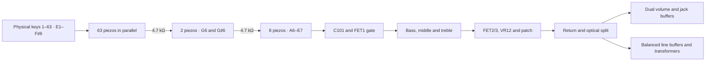

# Yamaha CP-70B

Select **Electric Grand → CP-70B** in Electric Pianos. The native compass is E1–E7. Play a note to see its hammer and course in the String Action diagram, or hold the diagram’s hammer to audition the displayed pitch. The instrument has a separate automatable model selector. Earlier Electric Grand sessions recall the CP-80.

## Action and pickup

The scale follows the service revision dated April 1978, serial 5001 onward. Physical key 42 corresponds to service key 49, A4 at 440 Hz. Yamaha specifies stretch offsets from −13 cents at E1 to +20 cents at E7. There is one wound string through F♯2, a wound pair from G2 through E4 and a plain pair from F4 upward. A6 has the last key damper. The probe exports all 73 rows with wire, hammer, damper, pickup stand and electrical branch. It also lists the original CP-70’s different wound-string part numbers. The playable model uses the B scale and TR board. [Service manual 006386, pp. 9–16](https://anaphonic.com/wp-content/uploads/yamaha_cp70b_sch.pdf) · [Yamaha comparative parts list, pp. 18–19, 28–31](https://manuals.fdiskc.com/tree/Yamaha/Yamaha%20Electric%20Grand%20Parts%20List%20for%20CP-70%20CP-70B%20CP-80.pdf)

The shared solver applies a compression-only hammer force to the speaking strings and reads their reaction at the bearing. The plain-wire calculation uses Yamaha’s wire numbers, nominal diameters, steel density of 7,850 kg/m³ and Young’s modulus of 200 GPa. It solves tension for the chart’s fundamental including the bending correction. Speaking lengths, wound-string tension and rigidity, hammer mass and contact, 0.8-cent unison separation, loss and damper strength are provisional. Loss starts from the nearest corresponding CP-80 construction. Direct recordings with identified output, EQ, dynamics and held and released notes are still needed to establish the accuracy of this voicing. [Scale and assumptions](../../src/seventy.rs) · [Hammer and string solver](../../src/lib.rs)



Each key contributes charge to its own branch. All 73 ceramic capacitances remain in circuit when their strings are silent. Each ceramic is assumed to be 1 nF. Yamaha specifies two 4.7 kΩ mixing resistors, 100 nF at C101 and 470 kΩ at R102. The live engine interpolates each branch and solves the whole electrical path at four times the host rate. It outputs the volume-controlled jack pair. The balanced branch is also present in the electrical reference. [Owner’s circuit and stand wiring, pp. 14–15](https://usa.yamaha.com/files/download/other_assets/0/322050/CP70BE.PDF) · [Trapezoidal pickup circuit](../../src/seventy_pickup.rs)

## Electrical checks

The SPICE deck drives TR IN at the service sheet’s −32 dBm reference. VR12 trims the patch gain and the effective photocell resistance sets the resting jack level. The resulting travel is 0.88356 and the effective resistance is 11.34 kΩ. The table shows the maximum tone settings except where indicated. JO1 has a 100 kΩ load and BO1 has a 10 kΩ load. JFET curves, photocell parameters and the transformer’s 3 H primary, 55 Ω series winding and unity turns ratio are estimates. [Factory adjustment, pp. 13–14](https://anaphonic.com/wp-content/uploads/yamaha_cp70b_sch.pdf) · [Circuit deck](tr.cir)

| Terminal and condition | Frequency | Service target | SPICE |
| --- | ---: | ---: | ---: |
| PO, gain trim | 500 Hz | −29 dBm | −29.00 dBm |
| JO1, resting level | 500 Hz | −31 dBm | −31.00 dBm |
| JO1 / BO1 | 50 Hz | −16.5 / −18.5 dBm ±1.5 | −16.98 / −19.49 dBm |
| JO1, bass down | 50 Hz | −34.5 dBm ±1.5 | −34.50 dBm |
| JO1 / BO1 | 5 kHz | −25 / −25.5 dBm ±1.5 | −25.80 / −26.53 dBm |
| JO1, treble down | 5 kHz | −40 dBm ±1.5 | −40.16 dBm |
| JO1, patch closed by cable | 500 Hz | −31 dBm ±1 | −31.00 dBm |
| BO1, jack volume down | 500 Hz | −30.5 dBm ±1.5 | −31.18 dBm |

An open patch gives −172.42 dBm at the jack. With volume down it measures −150.43 dBm. The three branches at physical keys 63, 64 and 66 give −36.85, −17.41 and −11.26 dB respectively to PO at 5.012 kHz. For the same three single-source sweeps to JO1, the Rust electrical path agrees with the full SPICE deck within 0.287 dB and 0.421° from 40 Hz to 10 kHz at a 192 kHz circuit rate. Applying the trapezoidal frequency mapping reduces the residuals to 0.0042 dB and 0.019°. These are small-signal comparisons.

The optical model shares the two antiphase LED drives with the CP-80. An installed VST3 render at 48 kHz compared a held A2 with and without tremolo, using 1 ms RMS windows from 0.5–5.5 seconds. The two speed endpoints measured 0.687 and 10.045 Hz against factory limits of 0.6–1.3 and 9–11 Hz. At maximum speed the left/right modulation measured 11.95%/12.00% at minimum depth and 44.27%/44.34% at maximum depth, within the factory limits of below 15% and above 40%. The cell light-to-resistance law and time constants still need measurements on an instrument. [Tremolo circuit](../tremolo.cir) · [Service adjustments 10–12](https://anaphonic.com/wp-content/uploads/yamaha_cp70b_sch.pdf)

## Reproduce

```sh
cargo run -p cp80 --example cp70b_probe -- target/cp70b-proof
python3 cp80/research/cp70b/bench.py target/cp70b-proof
cargo test -p openwurli-ui cp70b --quiet
cargo run -p cp80 --release --example cp80_probe -- bench cp70b
```

The Python comparison uses ngspice, NumPy and SciPy. The first command writes the course tables, three bus impulses, a boundary-note WAV and a stereo pedal/restrike phrase. The boundary notes are F♯2/G2, E4/F4, G♯6/A6 and A6/B♭6. Each strike lasts 0.5 seconds before key-up. Comparing 0.40–0.48 s with 0.65–0.73 s, A6 loses 105 dB and the undamped B♭6 loses 7.6 dB in the render. The CP-80 control was a 48 kHz E4 at velocity 0.68 held for 0.3 seconds. Its before/after WAVs were byte-identical, SHA-256 `528f07ed34ded4a75960701b9680b8dd509bd2f7b9157b68e0002c449eaf0e13`.

## Real-time checks

The release build uses finer collision steps above E6. A hard strike on every key from E6 to E7 was checked against the 384 kHz, double-precision solver. Across 44.1, 48 and 96 kHz host rates, the largest partial-level difference was 0.318 dB. The check measures up to eight partials below 16 kHz over 10–60 ms, including partials within 60 dB of the fundamental. The installed CLAP and VST3 both rendered CP-70B at all three rates. The VST3 played E1 and E7, and produced digital silence for MIDI 27 and 101 with Extended Notes off. The maximum performance peak after the +0.88 dB trim was −1.001 dBFS. [Upper-register verification](../../src/seventy.rs) · [Host output calibration](../../../openwurli-ui/src/tests/calibration.rs)

On an Apple M1 MacBook Air, the release benchmark struck all 73 keys under sustain and rendered one second in 64-frame blocks. The table shows a run of the compiled probe. A separate run at 96 kHz during concurrent work had a wall-clock outlier of 11.884 ms, above the 0.667 ms deadline.

| Host rate | Wall seconds per audio second | 99th percentile block | Longest block | Deadline |
| --- | ---: | ---: | ---: | ---: |
| 44.1 kHz | 0.171 | 0.382 ms | 1.057 ms | 1.451 ms |
| 48 kHz | 0.194 | 0.260 ms | 1.062 ms | 1.333 ms |
| 96 kHz | 0.370 | 0.275 ms | 0.598 ms | 0.667 ms |
