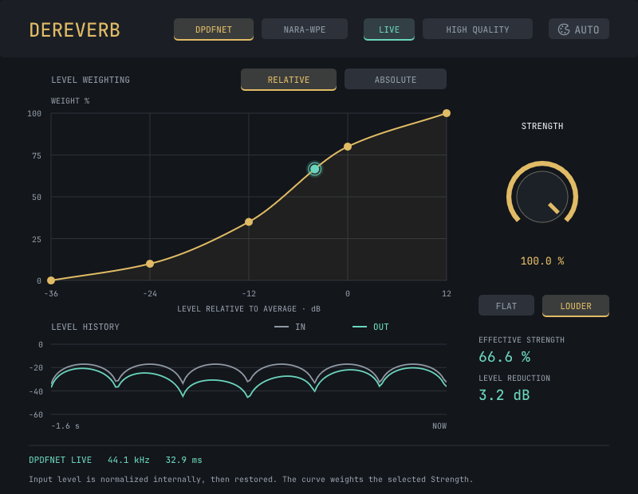

# Dereverb

Rust voice dereverberation with the shared Pleasant UI editor. This is a workspace
plugin built with NIH-plug, Vizia, RustFFT, DPDFNet, DTLN, and a native NARA-WPE port. No JUCE, CMake, or C++ plugin code.
ONNX Runtime remains a bundled native inference dependency, accessed directly from Rust.



## Build and install

From the `audio-plugins` workspace:

```sh
cargo check -p dereverb
cargo test -p dereverb --quiet
./dereverb/scripts/install.sh
```

The installer rebuilds the current checkout, packages ONNX Runtime and notices, signs and
verifies the bundles, and installs `Dereverb.vst3` and `Dereverb.clap` in the user audio
plugin folders. It builds for the current Mac's architecture. AU is not provided by this
NIH-plug port. The original repository is not needed to build or run it.

## Controls and processing

- **Strength**: 0–100%, default 100%, with a 20 ms automation ramp. DPDFNet and
  WPE interpolate spectral magnitude and phase; near-silent wet bins have little
  influence on phase. DTLN blends waveforms at the host sample rate. Drag, scroll,
  Shift for fine adjustment, click the value to type, or double-click to reset.
- **Transient Guard** (0–100%, default 100%): reduces processing on sharp attacks
  and consonants such as s, sh, and h across all engines. Drag or scroll the slider
  and hold Shift for fine adjustment. At 0% there is no protection. At 100% the
  guard can blend back up to 88% of the original signal. Presets saved with the
  old On/Off setting recall as 100%/0%.
- **Level weighting**: five vertically draggable points set 0–100% of the selected
  Strength. The smooth curve has no overshoot. Shift gives fine adjustment, scrolling
  changes the hovered point, and double-click restores that point to 100%.
  **Flat** (default) gives equal processing at every level; **Louder** favors louder sounds.
- **Relative** (default): horizontal axis is input level against a one-second RMS
  reference, from −36 to +12 dB. Scaling a whole recording preserves this weighting.
- **Absolute**: horizontal axis is original input RMS, from −72 to 0 dBFS. Upstream gain
  intentionally changes the weighting. Levels outside either graph use its endpoint weights.
- The teal dot shows the loudest channel's actual detector level and applied curve weight;
  **Effective Strength** includes the main Strength setting and the guard. The level detector uses 30 ms
  attack and 120 ms release. It reads the engine's 10 or 20 ms analysis window for
  DPDFNet and WPE, or 8 ms blocks of latency-aligned dry audio for DTLN. Channels
  process independently.
  Curve points and reference mode are automatable and saved in presets.
- **Engine**: **DPDFNet** (default), **NARA-WPE**, or **DTLN Denoise**. NARA-WPE is a native Rust port of
  the MIT-licensed recursive online algorithm; no Python runtime, model licence, or key.
  It predicts late reverberation from past spectra independently for each channel.
  Strength, Relative/Absolute weighting, and the live curve work with all three engines.
- **DTLN Denoise**: a speech noise suppression model that runs at 16 kHz. At full
  Strength and weight, the wet signal is limited to about 8 kHz. Lower Strength
  and Transient Guard blend back full-band dry audio. DTLN has one quality.
- **Live** (DPDFNet default): neural magnitude correction without deep filtering.
- **High Quality** (DPDFNet): the original full model with deep filtering.
- **WPE 10 ms / 20 ms**: the short path uses learned frequency-filter history; 20 ms
  retains the original predictor. These are analysis window lengths. They share the
  Quality parameter with DPDFNet's Live / High Quality choices.
- Mode changes take effect during playback. The previous mode continues until the new
  mode has filled its buffers, then their aligned outputs crossfade over 10 ms.
  Engine and quality are saved in presets and are not automatable. All five paths are
  prepared during initialization, so switching requires no audio-thread model loads or allocations.
- **Appearance**: shared Pleasant Dark / Light / Auto modes.
- **History**: 1.6 seconds of latency-aligned input and output RMS across all channels,
  with a −90 dBFS graph floor and readouts for the most recent 200 ms.

Matching mono through 16-channel layouts are supported. Host rates from **8–384 kHz**
are converted to and from the engine's native rate (48 kHz for DPDFNet and WPE; 16 kHz
for DTLN) using precomputed windowed-sinc filters (128 taps, or more for high-ratio
downsampling). Plans and tensors are prepared during initialization; the callback never
plans FFTs, creates tensor handles, allocates Rust storage, or locks the UI. ONNX's CPU arena is
warmed during initialization. Native inference is synchronous, as in the original engine;
these Rust allocation checks do not prove that ONNX itself never allocates internally.

All engines receive audio normalized to a −20 dBFS reference RMS. The original scale is
restored using the matching delayed analysis frame, so this is not output auto-gain.
The reference starts at the first nonzero frame and follows one-second average power;
there is no fixed input gate or gain cap. A constant gain change applied to the entire
input history scales the output by the same amount, within floating-point/model precision.
Changing trim during playback temporarily changes the reference until it adapts. The
weighting detector always reads the original input, before normalization. A zero curve
or 0% Strength retains the latency-aligned dry path.

At **48 kHz**, all modes normally report **2880 samples / 60 ms**. The shorter paths
are padded to match High Quality so the host can retain the same delay compensation
through a switch. At other rates, the host receives the integer latency including both filters and the
small conversion queue; fractional delay is compensated in the return filter. The editor
shows actual rate and latency. At 0% Strength the native path reconstructs to FFT precision;
converted DPDFNet and WPE paths are band-limited by sample-rate conversion. DTLN at
0% returns the full-band host input at the same latency.

NaN/Inf input is sanitized. Failed inference uses the aligned original while recurrent
state is reset and its delay refills (one frame in Live, four in High Quality).
DTLN uses band-limited dry audio until four valid hops have refilled its overlap
buffer. Runtime/model load failure is visible
and falls back to latency-aligned passthrough. If no engine loads, the plugin reports
zero latency. Transport reset clears model, filters, history,
and overlap buffers without reallocating.

This is a fresh plugin identity (`com.fergler.dereverb`); DPDFNet quality remains stored as
`quality`. The new `engine` parameter defaults to DPDFNet, preserving older saved states.
There is no JUCE preset importer or backward compatibility layer.

The Transient Guard compares 2 ms broadband and high-band envelopes with the
previous 12 ms and a rolling 192 ms history, per channel. Strong attacks briefly
blend in up to 88% of the latency-aligned original. Bright consonants can hold
protection for up to about 160 ms; steady hiss releases back to normal processing.
The detector uses the existing plugin delay to open before the attack is audible.
It adds no host latency and does not change model or WPE learning.

## DTLN

DTLN uses the [original ONNX exports](https://github.com/breizhn/DTLN/tree/1de1f15a8b5b7e1c44905618ff2ef70ca8277fbc/pretrained_model)
of the two-stage speech denoiser. The TFLite models in
[dtln-rs](https://github.com/hayatialikeles/dtln-rs/tree/43e8a58b7683cd336a37baaa7c315729b6857afc/model)
match the original project's full-precision TFLite exports byte for byte. Using the
ONNX exports keeps inference inside the same bundled runtime as DPDFNet.

The first stage masks a 512-sample FFT. The second stage refines the reconstructed
waveform, which is overlap-added in 128-sample hops. The plugin uses a 32 ms native
streaming delay plus conversion and alignment padding. Recurrent states are
independent per channel and reset on transport reset or when switching to DTLN.
DTLN is intended for background noise; its effect on room reflections depends on
the material.

## NARA-WPE

The implementation follows [`online_wpe_step`](https://github.com/fgnt/nara_wpe/blob/5fbfc3639274e5a70dffcf08e20615a38c372ebb/nara_wpe/wpe.py)
from NARA-WPE. **20 ms** retains the original 960-sample / 480-hop STFT, 10 contiguous
prediction taps, delay 3, and forgetting factor 0.99. **10 ms** uses a 480-sample /
240-hop STFT. Its ten taps remain spaced 10 ms apart, spanning 40–130 ms into the past;
the 140 ms power history, forgetting time, and level-detector attack/release retain their
physical durations. Shortening the window does not shorten the room prediction history.

The short path uses a half-second moving average of the learned complex prediction
coefficients in each frequency bin. These coefficients describe the frequency, phase,
and delay of the estimated reverberant component. Repeated patterns influence future
removal, while fleeting estimates have less effect on the audible predictor. The ordinary
instantaneous residual still updates the recursive solver, avoiding a feedback loop that
trains directly on its own smoothed output. This is a plugin extension to NARA-WPE, not an
upstream feature or an explicit measured room impulse response. It adds no lookahead.
The original 20 ms path does not use this smoothing, so it remains available for comparison.
Both modes limit the audible residual using the estimated late-reverb power. This keeps
the prediction from adding energy to quiet bins during a decay. The postfilter leaves
the recursive solver's update unchanged.

Both paths process channels independently, not as a joint microphone array. This is the
online algorithm, not the offline iterative solver. It does not require a trained voice
model or perform explicit denoising. Allow a few seconds of representative audio to settle.
Sustained predictable sounds can also be attenuated. Transport reset and mode switching
clear the learned filters; there is no persistent room calibration or Hold mode.

Double-precision complex state preserves Hermitian covariance symmetry. Completely empty
histories freeze adaptation; inverse covariance is bounded in unexcited subspaces. Invalid
bins reset with a frame of aligned passthrough. Buffers and FFT plans are allocated at
initialization; processing, reset, and switching do not allocate Rust storage.

`scripts/check-wpe-reference.py` regenerates `testdata/wpe-reference.f64` using the unmodified
upstream Python function at the pinned revision. The original configuration still matches
240 frames across four spectral scales with absolute complex error below 1e-10.

### Short-window comparison

Before the residual postfilter, the 10 ms choice was screened against 20, 15, 7.5, 5,
and 2.5 ms analysis using two local
speech recordings, each clean and convolved with three deterministic simulated rooms
(RT60 0.25, 0.55, and 0.9 seconds). The comparison uses the actual Rust processor, aligns
latency, preserves a common gain, and excludes the first two seconds from speech metrics.
The target retains direct sound and reflections in the first 35 ms. Results and method
are recorded in `docs/wpe-window-results.json`; recordings are not committed.

For 10 ms with learned filter history, tail levels differed from the original by at most
0.64 dB in the worse direction across the six reverberant cases. SI-SDR against the target
was 0.27–0.62 dB lower; clean-speech SI-SDR improved by roughly 4 dB. Thus this is a latency /
quality tradeoff, not a claim of identical sound or better removal in every room. The 5 ms
and 2.5 ms candidates left more reverberation during speech. Denser predictor variants
recovered some of that but increased residual tails and processing cost. Power-only
history weighting and feedback from the cleaned spectrum did not give a better balance.

These are objective checks on simulated rooms, not a controlled listening study. Compare
10 and 20 ms on the intended voice/room; the original path is retained for that reason.
To reproduce with any mono speech files of at least seven seconds (NumPy, SciPy, soundfile):

```sh
python3 dereverb/scripts/evaluate-wpe-windows.py \
  --voices /path/to/voice1.wav /path/to/voice2.wav --out /tmp/wpe-window-study
```

This invokes an ignored release-mode Rust render test and writes metrics plus level-aligned
`compare-input.wav`, `compare-original-20ms.wav`, and `compare-short-10ms.wav`. Python is
needed only for this evaluation, not to run the plugin.

## Live model

The original graph is kept unchanged for High Quality. Live reuses its trained normalization,
encoders, and magnitude decoder, removes the deep-filter decoder and filter buffers, and
applies the magnitude mask to the previous input spectrum. The resulting 960-sample STFT
plus one 480-sample frame gives a real 1440-sample delay. The original phase is preserved;
this is a different processing path, not a transparent optimization of High Quality.

Live uses the existing weights without retraining, and retimes the magnitude correction
by one frame relative to the upstream mask. Expect differences in attenuation, transient
handling, and room removal. High Quality retains the original deep-filter path for final
processing. A small two-voice check of the model graphs found roughly 1.25 dB of clean-speech
attenuation in Live before the plugin's level normalization; this is a smoke comparison,
not a perceptual-equivalence claim. Use Strength to choose the correction by ear.

`scripts/export-live-model.py` reproducibly derives the bundled Live graph using
`onnx==1.19.1` and NumPy. It checks the source SHA256 and state offsets, removes unreachable
nodes, and runs ONNX's full checker. The derived graph has 375 nodes and 15,590 state floats.
The relevant upstream definitions are the [HR graph](https://github.com/ceva-ip/DPDFNet/blob/main/onnx_model/dpdfnet_48khz_hr.py)
and [deep filter](https://github.com/ceva-ip/DPDFNet/blob/main/onnx_model/multiframe.py).

## Verification

The focused tests cover magnitude/phase interpolation, hot-input dry reconstruction,
sample-rate conversion and impulse alignment from 8–384 kHz, anti-alias rejection, room
tail reduction, multichannel isolation, NaN handling, failed-inference recovery, repeatable
transport resets, host latency publication, and Rust allocation checks in both modes.
Mode-switch tests cover continuous aligned audio, uninterrupted level history, and allocation-free switching.
Level tests cover normalization and Relative weighting over −60 to +12 dB gain changes,
both models, native/converted rates, startup, silence, reset, zero-weight dry reconstruction,
and exact agreement between the graph evaluator and audio detector. Tonal fixtures allow
a compensated residual below 0.1% of input RMS to account for neural sensitivity to float
roundoff in nearly empty spectral bins.

To render the actual canvas artwork without a DAW on macOS:

```sh
cargo test -p dereverb render_editor_preview --quiet -- --ignored
```

This writes `/tmp/dereverb-dark.png` and `/tmp/dereverb-light.png` at different scales.
Live host pointer/DPI/automation checks are still a separate validation step.

To run the installed CLAP bundle through the included offline host:

```sh
python3 dereverb/scripts/check-installed.py
```

It verifies model loading from the installed bundle, lifecycle calls, Strength changes,
dry/wet processing, variable blocks (1–511 samples), stereo agreement, and reported
latency at 44.1, 48, 96, and 192 kHz in all five processing paths. It also checks that
all five modes engage during playback at the same latency and that settings survive preset
save/load. The same Rust processor is exported as VST3.

## Assets and licenses

NARA-WPE: Communications Engineering Group, Paderborn University, MIT.
DPDFNet: CEVA, Inc. and contributors, Apache-2.0. DTLN: Nils L. Westhausen, MIT.
ONNX Runtime 1.23.2: Microsoft, MIT.
Full licenses and runtime third-party notices are in `licenses/` and copied into bundles.
The Rust plugin follows this workspace's GPL-3.0-or-later licensing.

The HR model and runtime were imported from the provided `dereverb-vst3` checkout;
the Live model was derived here with the exporter above:

```text
dpdfnet2_48khz_hr.onnx   SHA256 7f0575a5cec0ba4ffd8f8bd657e06d007e4ccdd955d76faab922b9d3291dc14b
dpdfnet2_48khz_live.onnx SHA256 95b38018e14809ea5697c42271b20597305fbfa46f1341f78ac218e62e1097e1
dtln_1.onnx             SHA256 22b91cae3855e5a0620e66a917ca6c82c58db0e842c770f58d86751c5e8d4ae3
dtln_2.onnx             SHA256 e20c92f9233fccf29cddf86970d0d0161a03aebccc26d6f4d5639c4d5ec2e639
libonnxruntime.dylib    SHA256 0db0b1b76bf05cde8b19c4c6435c0ba00657c90ed8df2c069133cf6694eb52c3
```
