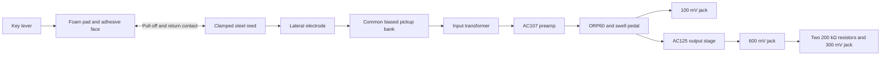

# Pianet, Cembalet, Claviset and Pianotron

The playable bank covers the N’s 61 keys (F1–F6) and the T’s 60 keys (F1–E6). The two instruments share a clamped-beam solver, finite-speed key travel and return contact. Each has its own pad release law, scale and electrical path. The T includes a separate comparison against Greg Sullivan’s physical instrument. [Pianet T model and validation](research/pianet-t.md)

The live N reads the 600 mV jack, with a 250 kΩ swell and an optical vibrato switch. Its 6 Hz astable drive alternates lamp power. Heating and cooling time constants are provisionally 22 and 46 ms. The corresponding ORP60 conductance controls the physical branch in parallel with the intensity trimmer. The loaded circuit is updated at roughly 960 Hz while preserving the capacitor and winding states. The dry circuit uses the estimated dark-cell operating point. The loaded sine test checks both modulation sidebands and the full, half and closed swell positions. The fitted cell, lamp duty and the depth on a real N still need measurement. [Hohner circuit](https://www.clavinet.com/Pianet_N_schematic.pdf) · [Factory modulation description](https://www.manualslib.de/manual/1459627/Hohner-Pianet-N.html?page=6)

Both live models preallocate each physical key and process it at twice the host sample rate. A 65-tap low-pass gives 16 frames of host latency. Mouse and MIDI ownership can overlap on the same note. Regression checks cover native key limits and middle-register pitch and level at 44.1, 48 and 96 kHz. The N interpolates the estimated anchor geometry across its compass. The three-key reference below retains the full-swell dry setup and 192 kHz integration used for the factory comparison.

The factory C, L, N and T return the pad on key-up. **Sustain Mod** enables a virtual pedal-operated catch. With CC64 down, a released key leaves its detached pad raised while the reed rings. Releasing the pedal or disabling the switch returns caught pads and applies the selected pad-return noise at contact. A repeat first lowers the pad onto the moving reed. The model lifts it again when the adhesive face or suction seal has recovered half its contact area. That threshold is a design choice for the modification. The Duo uses the same catch on its reed action.

The early Pianet C and L, both Cembalets, the Weltmeister Claviset 200 and the Selmer 8701 have separate electrical outputs. The shared reed engine also exposes pickup distance, extended notes and the Pianets’ return-contact level. [C and L circuits](research/pianet-cl.md) · [Cembalet circuits](research/cembalet.md) · [Claviset and Selmer owner comparisons](research/claviset.md) · [Eight-board measurements and listening fixtures](research/variant-audit.md)

## N reference keys

The offline instrument plucks A2, E4 and A5 with a sticky pad, keeps the beam moving through key-up and reads its tip at a biased side electrode. All vibrating keys feed the same input transformer. A second run adds C4 and G4 around the middle anchor specifically for Hohner’s output test. The dry circuit follows drawing **30 002 167 D** with the foot swell fully open. A board photograph, serial and dry recordings from the same specimen are still needed to pin down this revision’s voicing. [Hohner circuit](https://www.clavinet.com/Pianet_N_schematic.pdf) · [Hohner manual, action and electrode regulation](https://www.manualslib.de/manual/1459627/Hohner-Pianet-N.html?page=6)



## Hear and inspect a run

```sh
cargo run -p pianet-n -- target/pianet-n-probe
python3 pianet-n/research/compare.py target/pianet-n-probe
```

The comparison uses NumPy, SciPy and ngspice. Open `pianet-n-audition.wav` for the three registers followed by the triad, all at the 600 mV jack with common gain. The individual `key-*.wav`, `repeats-*.wav` and `factory-triad.wav` contain 48 kHz floating-point voltages from the 100, 300 and 600 mV jacks in that order. The adjacent CSV files expose pad and reed travel, contact force, attachment, seating fraction, capacitance and summed drive current. A CSV row is a snapshot every eight output samples. Mechanical integration runs at 192 kHz. A 129-tap low-pass precedes downsampling.

The repeat sequence starts at velocity 45, then gives the pad 3 ms and 22 ms to return before repeating at the same velocity. The final velocity-110 strike follows a 235 ms return. The first gap leaves the pad clear of the reed. The second permits a partial bond. On key-up the descending pad damps the reed at its contact point. The pedal shown on the drawing controls volume. [Hohner manual, swell pedal and output](https://www.manualslib.de/manual/1459627/Hohner-Pianet-N.html?page=5)

## Action and transducer

The beam uses the clamped-free Euler–Bernoulli roots, normalized at the free end. Up to eight transverse modes below 20 kHz respond to the force at 83% of the free length. Each mode advances by its analytic damped rotation and forced step response. An implicit point spring and dashpot give the force needed to follow the moving pad. Adhesion breaks above a tensile force set by seating and pull speed. On return, compressive contact damps the beam and rebuilds the bond with a 25 ms time constant. Modal position and velocity persist throughout. The initial state solves for static preload. Hohner describes a soft compound pad with a leather face and a temporary bond to the reed. The Powerhouse’s 1965 N has recreated pads, illustrating how a restoration changes this comparison. [Bierl and Zacharias, US3423514A](https://patents.google.com/patent/US3423514A/en) · [Powerhouse instrument and restoration notes](https://collection.powerhouse.com.au/object/612341)

| Anchor | Free length | Width | Lateral gap | Static tip deflection used to set pull-off force |
| --- | ---: | ---: | ---: | ---: |
| A2 | 66 mm | 5.2 mm | 0.20 mm | 1.00 mm |
| E4 | 43 mm | 4.6 mm | 0.35 mm | 0.64 mm |
| A5 | 28 mm | 3.8 mm | 0.58 mm | 0.38 mm |

The table contains estimates. The model treats each reed as rectangular steel with density 7,850 kg/m³ and Young’s modulus 200 GPa. It infers thickness from equal-tempered pitch, length and stiffness. The real reeds can have longitudinal section changes. The pad’s compression, contact area growth, speed law and mode losses await measurements. Clearance sets level and nonlinear response. A smooth, finite-width approximation of overlap at a lateral electrode edge gives capacitance from tip displacement. Each reed contributes current proportional to its capacitance change under 300 V polarization. The linear electrical load uses a fixed estimate of the bank and wiring capacitance. Hohner describes a 300 V operating potential and its schematic labels the supply before the 20 MΩ feed at 400 V. [Hohner action and voltage](https://www.manualslib.de/manual/1459627/Hohner-Pianet-N.html?page=6) · [Hohner circuit](https://www.clavinet.com/Pianet_N_schematic.pdf)

| Anchor | First detached trace after key-down | Tip at that trace | 22 ms repeat relative to seated strike | Level 50–90 ms after key-up relative to held level |
| --- | ---: | ---: | ---: | ---: |
| A2 | 6.69 ms | 1.276 mm | −5.8 dB | −39.7 dB |
| E4 | 4.69 ms | 0.920 mm | −4.4 dB | −84.3 dB |
| A5 | 2.85 ms | 0.526 mm | −7.9 dB | −89.4 dB |

These are model predictions for a future matched key-travel and DI session. The hard-to-soft differences in 16–96 ms RMS are −0.1, +0.6 and +1.0 dB respectively. The bass dynamic slope and the high-register damping need measurements at controlled key speed. The focused tests cover pull-off, missed repeats, partial reseating, settled displacement and state retention.

## Circuit and factory comparison

The transformer model uses a provisional 10:1 reduction, 220 H magnetizing inductance, 1.6 kΩ copper loss, 2 MΩ parallel loss and 180 pF of bank and stray capacitance. The AC107 and AC125 use estimated small-signal transconductances of 14 and 40 mS and current gains of 70 and 54. The dry ORP60 is assigned 3 MΩ with the 100 kΩ intensity trimmer at half travel. Source resistors, bypass capacitors, coupling, pedal and jack wiring come from the drawing. The oscillator duty, transformer saturation and transistor overload need separate characterization. A different Hohner N sheet documents another board. [Early N schematic](https://www.clavinet.com/Pianet_N_schematic.pdf) · [Other N revision](https://www.clavinet.com/Pianet_N_Version2_schematic.pdf)

The Rust amplifier reuses the workspace RLC solver. A separate ngspice deck retains distinct primary and secondary grounds and controlled sources for the transformer. Across 20 Hz–20 kHz, its three output responses and the Rust impulse agree within **0.0004 dB and 0.009°** after accounting for the bilinear frequency mapping.

Hohner specifies an approximate 100/300/600 mV for a mid-keyboard triad at full swell. The probe sounds C4–E4–G4 simultaneously at velocity 80 and measures the first 200 ms from key-down. The manual gives 100 kΩ, 200 kΩ and 7 kΩ alongside the three ports. The table exposes the effect of treating those impedances as receiver loads. The source leaves meter ballistics, chord voicing and strike force unspecified. [Hohner output test](https://www.manualslib.de/manual/1459627/Hohner-Pianet-N.html?page=5)

| Jack | Hohner nominal | Peak into 10 MΩ per jack | RMS into 10 MΩ per jack | Peak with one receiver at listed impedance |
| --- | ---: | ---: | ---: | ---: |
| Low | 100 mV | 129 mV | 38 mV | 104 mV |
| Middle | 300 mV | 383 mV | 113 mV | 257 mV |
| High | 600 mV | 774 mV | 229 mV | 397 mV |

The high-impedance peak ratios are 1:2.96:5.98. The high jack falls 34% below its nominal reading in the 7 kΩ receiver test. Measuring one identified board under both loads would distinguish output impedance, stage gain and level convention.

## Independent audio comparison

OTO×NOMA publishes a short performance played on Spectrasonics’ sampled Pianet N. The final held chord has a resolvable E4 component. In 150 ms Hann windows starting from 2.85 to 3.33 seconds, its fitted level slope is **−7.69 dB/s** (0.04 dB RMS residual). The model’s isolated E4 fundamental gives **−7.55 dB/s** (0.08 dB RMS residual) over the corresponding 480 ms span. This is a narrow comparison of held-note decay on sample-library playback. The player, effects, recording gain and other chord tones preclude using it to calibrate physical pull-off or key return. The service triad remains the electrical reference. [Performance, “KEYSCAPE Pianet N”](https://kensukeinage.com/keyboard_ep_soundmake/) · [Spectrasonics instrument](https://www.spectrasonics.net/products/keyscape/models/pianet-n/)

```sh
curl -fL https://kensukeinage.com/wp-content/uploads/2022/03/Keyboard_EP_Soundmake_Preset04.mp3 -o target/pianet-n-probe/reference.mp3
python3 pianet-n/research/compare.py target/pianet-n-probe --sampled-performance target/pianet-n-probe/reference.mp3
```

The optional comparison verifies the reference file hash and uses SoundFile with MP3 decoding. A photographed early instrument with its serial, fitted pads, electrode clearances, isolated recorded keys and measured output loads would support independent attack and release fits.

## Cembalet

The early tube Cembalet and transistor Cembalet N 650720 have their own plectrum, sprung damper, native compass, swell and receiver. See [the service fixtures, jack results and recording comparison](research/cembalet.md).

## Pianet C and L

The 1963 C and mains E71 L retain distinct amplifier circuits, knees and two live output paths. [Original board evidence, electrical checks, owner recordings and repro commands](research/pianet-cl.md)
