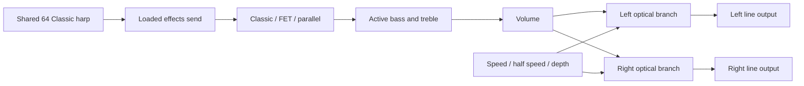

# StereoVibe on the 64 Classic

The August 2013 launch sheet offered a powered Stereo Vibe preamplifier for the same 64-key harp as the passive Classic. The modeled option is the mains-powered **Rev 4.1 board with the October 2014 service correction**. The board photograph on bulletin CSB0001 p. 2 reads *REV 4.1 1210*. The bulletin specifies 1 MΩ at R52/R53 to reduce the level drop when enabling tremolo and 20 kΩ at R31/R32 to improve the available depth. Some early boards received the correction at the factory. The bulletin contains an assembly photograph, but no complete circuit drawing or measured frequency response. [2013 launch sheet, p. 3](https://www.fenderrhodes.com/pdf/64classic.pdf) · [Vintage Vibe CSB0001, both pages](https://cdn.shopify.com/s/files/1/0666/2821/files/Stereo_Vibe_Service_Bulletin.pdf)

The owner’s manual, printed pp. 4–7, identifies three front-panel knobs. Volume stands alone. A concentric bass and treble control has a half-speed push switch. The second concentric control sets speed and depth and switches the effect on or off. The internal DIP bank selects the Peterson-style Classic input, a high-impedance FET input or the two in parallel. The send jack exposes the harp before the preamp. The left and right line outputs carry the stereo effect. The separate headphone amplifier and console speakers are outside the line-output model. [Maker’s manual, control and jack diagrams](https://cdn.shopify.com/s/files/1/0666/2821/files/owners_manual.pdf) · [Maker’s active/passive comparison](https://www.vintagevibe.com/blogs/news/vintage-vibe-pianos-active-vs-passive)



## Signal model and boundaries

The preamp reads the existing pickup voltage after decimation. An RLC winding terminates in the installed input impedance. The Classic input uses 33 kΩ and 390 kΩ bias arms with an estimated 150 kΩ incremental transistor input, based on the Peterson reference circuit. The FET path presents an estimated 1 MΩ gate load. Selecting both puts those loads in parallel. The active send is the voltage at the harp side of the 0.22 µF coupling capacitor. Its passive sibling has the additional tone controls, volume pot and cable load downstream of the winding. The plug-in shares the original modeled A1–C7 fork, hammer, pickup setback, extension and dampers. Nine four-channel pre-change passive captures at E2, C4 and C6, each at three velocities, remained byte-identical after separating the panels. [Peterson reference circuit](https://cdn.shopify.com/s/files/1/0666/2821/files/peterson_pre_amp_schematic_-_rebuild_kit.jpg) · [Shared action and original passive validation](../README.md)

The two input-stage gains, FET saturation curve, centered shelf frequencies of 140 Hz and 1.8 kHz, ±12 dB shelf range and pot tapers are estimates. At a 1 mV sine drive and neutral EQ, the Classic, FET and parallel settings give modeled dry-jack gains of +4.29, +7.22 and +5.40 dB at 440 Hz. At 5 kHz they give +1.54, +8.54 and +2.53 dB. An independent complex-impedance calculation agreed within 0.00023 dB at the input/send and neutral output over 36 checks. This verifies the proposed input network numerically. The FET setting’s 10 kHz harp resonance and the actual board EQ range still require bench measurement. [Panel model](../src/stereo.rs) · [Analysis](stereovibe.py)

The two four-lead packages alongside the bulletin’s channel-pair resistors are consistent with opposed optical gain paths. The implementation uses an estimated series photocell and a 20 kΩ receiving impedance, with matching per-channel dry level at zero depth. R52/R53 identify the serviced version. Their exact connections and the optocoupler part numbers have yet to be established. The effective control-path time constants of 69 ms and 16 ms were fitted to the maker’s stereo envelope. They describe the modeled driver and cell together. The speed pot spans an estimated 1.5–9 Hz before the half-speed switch. None of the videos maps both pot stops. The later Rev 8 introduces a battery supply and revised EQ and tremolo. [Rev 4.1 board and correction](https://cdn.shopify.com/s/files/1/0666/2821/files/Stereo_Vibe_Service_Bulletin.pdf) · [Maker’s description of the Rev 8 changes](https://www.vintagevibe.com/products/stereovibe)

## Stereo recording comparison

Vintage Vibe identifies the 8 October 2014 John Ginty performance as a **64 Classic active with stereo console**. It was published two days after CSB0001. The recording and camera cannot identify the exact PCB or whether the resistor changes had been applied. The 2010 Sigma Sound recording is Vintage Vibe’s earlier preamp installed in a Fender Rhodes. The 2020 independent recording identifies an active Classic 64 and says the first half uses only onboard tremolo and EQ. Its later echo and reverb passages are excluded. [Ginty, maker’s recording](https://www.youtube.com/watch?v=KI3QFfSCjz8) · [Sigma Sound, maker’s retrofit demonstration](https://www.youtube.com/watch?v=3HtfWSbmuAc) · [Unden, independent active Classic 64](https://www.youtube.com/watch?v=no5pmOqRbss)

The comparison band-limits each channel to 100–2,200 Hz and forms the normalized left-minus-right energy in 5 ms frames. Folding over 64 oscillator phases reduces the effect of played notes. The first Ginty window sets the response times. Its later window uses the same controls. Other windows use their observed rates and an apparent depth estimated from the span of the folded envelope. Those are matched settings. The comparison tests the shape of the pan. The third harmonic measures departure from a sine wave. RMS discrepancy is in normalized energy difference, whose range is −1 to +1.

| Source and time | Measured rate | Hardware / model envelope third harmonic, dBc | Folded envelope RMS discrepancy |
| --- | ---: | ---: | ---: |
| Ginty 5–13 s, fit | 1.836 Hz | −11.27 / −11.26 | 0.063 |
| Ginty 117–125 s, same controls | 1.834 Hz | −11.35 / −11.26 | 0.063 |
| Independent Classic 40–47 s | 5.517 Hz | −17.53 / −17.04 | 0.067 |
| Independent Classic 65–70 s | 1.065 Hz | −11.33 / −10.71 | 0.084 |
| Sigma retrofit 26–35 s | 6.426 Hz | −27.86 / −16.55 | 0.128 |
| Sigma retrofit 47–56 s | 1.563 Hz | −13.42 / −11.25 | 0.118 |
| Sigma retrofit 68–77 s | 0.911 Hz | −10.93 / −10.07 | 0.109 |

On Ginty’s first window, left/right power balance spans −49.8 to +55.5 dB between its fifth and ninety-fifth percentiles. The model reaches ±59.1 dB at full depth. On the independent slow setting the same percentiles span −9.7 to +11.4 dB against ±5.6 dB in the model. The 2010 retrofit has a smoother fast pan than the modeled serviced board. The footage leaves room acoustics, DI mix, original cell matching and pot settings unresolved.

```sh
cargo run --release -p vintage-vibe-64 --example stereovibe_probe -- target/stereovibe-probe
python3 vintage-vibe-64/research/stereovibe.py target/stereovibe-probe \
  --ginty /private/tmp/stereovibe-ginty.wav --intro /private/tmp/stereovibe-intro.wav \
  --sigma /private/tmp/stereovibe-sigma.wav
```

Decode the three public recordings to 24 kHz stereo WAV. The probe writes stereo chord and 440 Hz pilot WAVs in volts, plus the input sweep. The analysis writes per-window CSV measurements and three short local hardware-then-model reels. The model segments play one chord for identifying stereo motion. They do not recreate the musicians’ performances.
